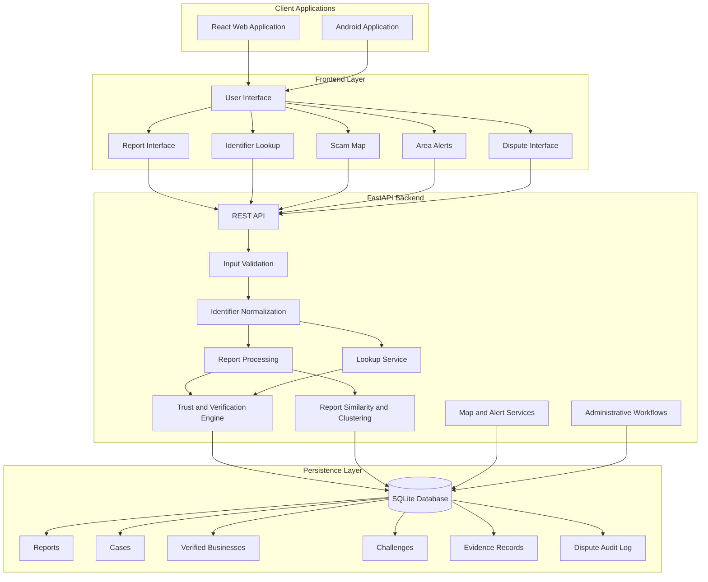
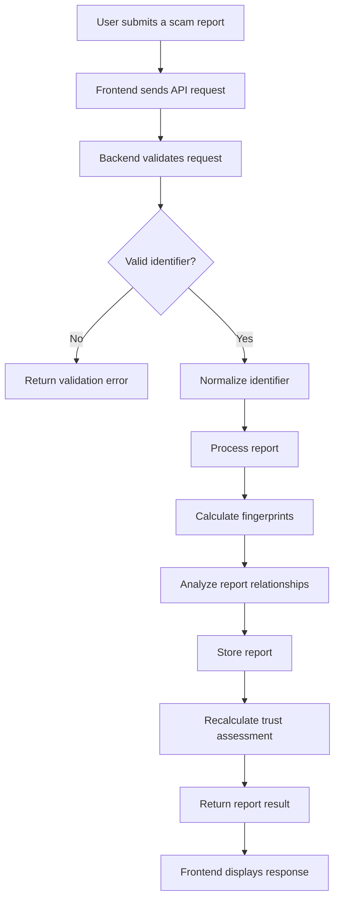
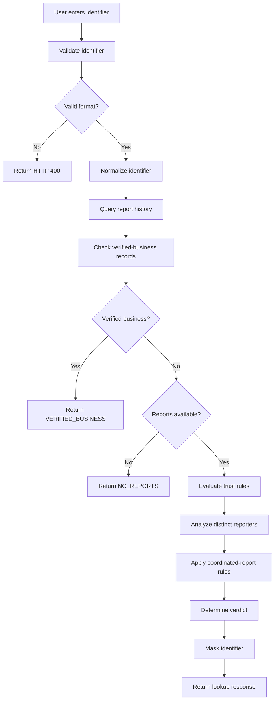
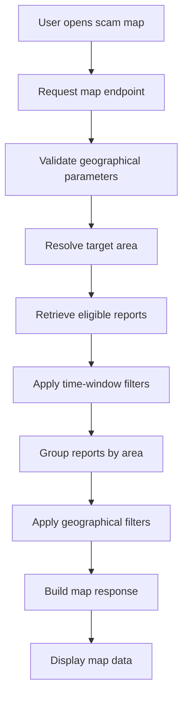
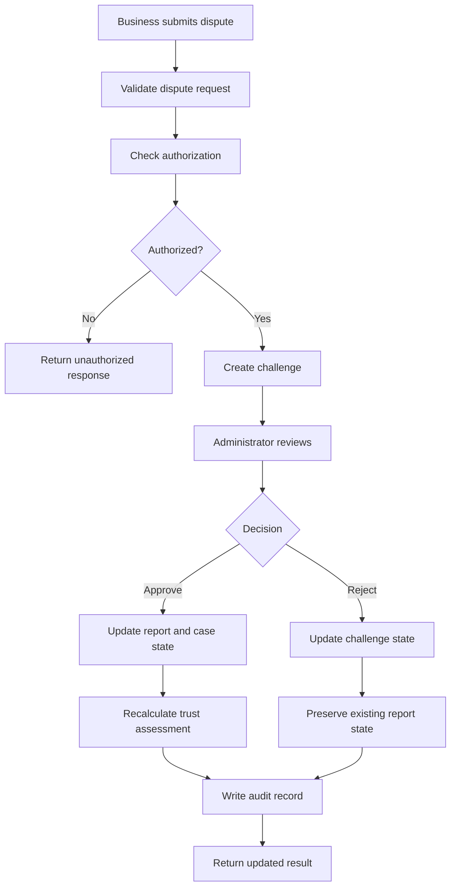
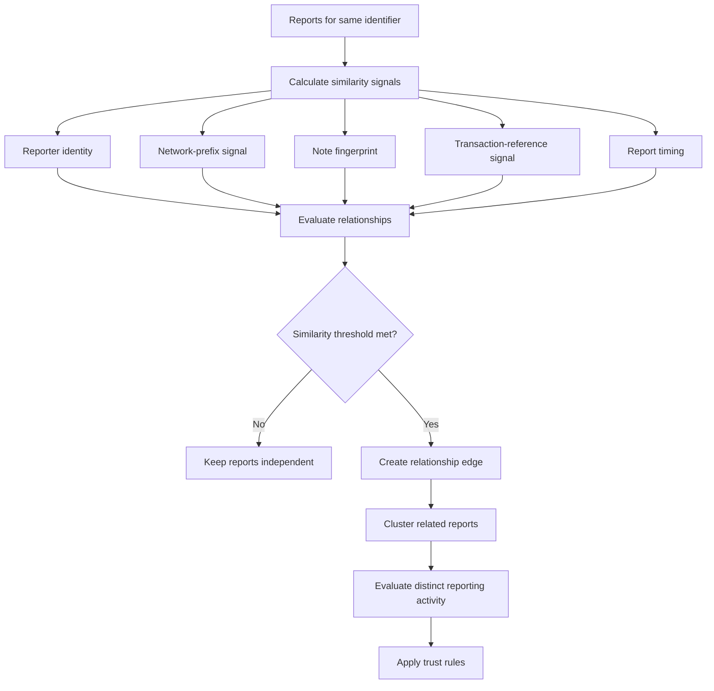

# 🛡️ CyberForge — Community Scam Map

### Community-powered scam reporting, verification, and intelligence

Live link : - https://cyber-gamma-brown.vercel.app/#/report

CyberForge is a community-driven scam reporting and verification platform designed to help people identify suspicious phone numbers, UPI IDs, URLs, SMS senders, and other digital identifiers.

The platform collects community reports, evaluates reporting patterns, applies trust and verification rules, and presents privacy-conscious scam intelligence through a simple web and Android interface.

Instead of treating every report as proof of fraud, CyberForge evaluates the number of distinct reporters, report patterns, identifier history, verified-business records, and other available signals to produce a more responsible verdict.

**Built for CyberForge Hackathon | Mitigata | Bengaluru**

---

## 📌 Table of Contents

- [Overview](#-overview)
- [Problem Statement](#-problem-statement)
- [Our Solution](#-our-solution)
- [Key Features](#-key-features)
- [System Architecture](#-system-architecture)
- [Technology Stack](#-technology-stack)
- [How CyberForge Works](#-how-cyberforge-works)
- [Trust and Verification Engine](#-trust-and-verification-engine)
- [Privacy and Security](#-privacy-and-security)
- [API Reference](#-api-reference)
- [Project Structure](#-project-structure)
- [Installation and Setup](#-installation-and-setup)
- [Android Application](#-android-application)
- [Testing](#-testing)
- [Demonstration Workflow](#-demonstration-workflow)
- [Limitations](#-limitations)
- [Future Improvements](#-future-improvements)
- [Team](#-team)

---

## 🌍 Overview

Online scams increasingly involve impersonation, fraudulent payment requests, fake customer-support numbers, suspicious links, and social engineering.

People often discover that an identifier is suspicious only after they have interacted with it or transferred money.

CyberForge aims to make community scam intelligence accessible before users make potentially risky decisions.

### Our objective

Build a platform that enables users to:

1. Report suspicious identifiers.
2. Check whether an identifier has previous community reports.
3. Understand the platform's assessment.
4. Explore scam activity by geographical area.
5. View area-based alerts.
6. Challenge incorrect classifications through a dispute workflow.

### Project principles

- Community-driven intelligence
- Explainable verification rules
- Privacy-conscious reporting
- Responsible threat classification
- Transparent investigation workflows
- Accessible web and Android experiences

---

## 🚨 Problem Statement

Existing scam-awareness approaches often suffer from several limitations:

### 1. Lack of accessible community intelligence

Users may have no convenient way to check whether a phone number, payment identifier, or suspicious link has been reported by others.

### 2. False confidence from report counts

A large number of reports does not automatically mean an identifier is fraudulent.

Coordinated accounts, repeated submissions, and duplicate reports can artificially increase report counts.

### 3. Limited geographical awareness

Users may benefit from understanding scam activity reported in their local area rather than seeing only isolated identifiers.

### 4. Incorrect classifications

Legitimate businesses and service providers may be reported incorrectly.

A responsible system needs a way to recognize verified businesses and allow disputes.

### 5. Privacy concerns

Scam reporting should not expose the identity, network information, or private notes of people submitting reports.

---

## 💡 Our Solution

CyberForge provides a unified platform for community reporting, identifier lookup, trust evaluation, geographical scam intelligence, and business disputes.

The application combines:

- A React frontend for user interaction.
- A FastAPI backend for API processing.
- SQLite for persistent application data.
- A trust engine for report evaluation.
- Report similarity and clustering logic for coordinated activity.
- Verified-business records for legitimate entities.
- Map and alert endpoints for geographical intelligence.
- Administrative workflows for investigations and disputes.

The result is a system that evaluates community reports rather than blindly counting them.

---

## ✨ Key Features

### 📢 Community Scam Reporting

Users can submit suspicious identifiers with relevant report details.

Supported identifier categories depend on the backend validation rules and include:

- Phone numbers
- UPI identifiers
- URLs
- SMS senders
- Email addresses
- Other supported identifier categories

The backend validates and normalizes submitted identifiers before processing them.

### 🔎 Identifier Lookup

Users can check an identifier to understand its current assessment.

The lookup response can include:

- Verdict
- Report count
- Distinct reporter count
- First and last reported timestamps
- Masked identifier
- Available evidence details
- Challenge status

### 🧠 Trust and Verification Engine

CyberForge applies deterministic verification rules to evaluate community reports.

The engine considers factors such as:

- Distinct reporter count
- Report history
- Duplicate report patterns
- Coordinated reporting signals
- Verified-business records
- Challenge and dispute state

The final verdict is produced by the implemented trust rules.

### 🕸️ Coordinated Reporting Detection

The platform analyzes relationships between reports to identify potentially coordinated reporting activity.

Available signals may include:

- Reporter identity hashes
- IP-prefix hashes
- Note fingerprints
- Transaction-reference fingerprints
- File hashes, where applicable to the current implementation
- Report timing and similarity

Related reports can be grouped into clusters to reduce the influence of coordinated submissions.

### 🗺️ Geographical Scam Map

The map endpoint provides area-based scam intelligence.

The backend filters reports according to its geographical and time-window rules, groups relevant reports, and returns map data.

The map is designed to communicate geographical patterns without exposing precise reporter locations.

### 🚨 Area-Based Alerts

Users can retrieve alerts associated with a geographical area.

Alerts provide an additional way to understand potentially relevant scam activity beyond checking one identifier.

### 🏪 Verified Businesses

CyberForge maintains verified-business records to reduce the risk of legitimate businesses being incorrectly classified.

Verified-business checks take priority according to the implemented trust rules.

### ⚖️ Business Disputes

The dispute workflow allows an eligible business or administrator to challenge an incorrect classification.

Administrative decisions can update the relevant challenge and report state while preserving an audit trail.

### 🔐 Privacy-Conscious Results

Public lookup responses are designed to avoid exposing reporter identities, raw IP addresses, or private report notes.

Identifiers are masked according to the implemented privacy rules.

---

## 🏗️ System Architecture

CyberForge follows a client-server architecture.

The frontend communicates with the FastAPI backend through HTTP APIs.

The backend validates requests, applies business and trust rules, accesses persistent storage, and returns structured responses.

### Architecture Diagram



### Architecture Explanation

| Layer | Responsibility |
|---|---|
| Client | Web and Android user experiences |
| Frontend | Reporting, lookup, map, alerts, and dispute interfaces |
| API | Receives and routes HTTP requests |
| Validation | Checks submitted data and identifier formats |
| Normalization | Converts supported identifiers into canonical forms |
| Report processing | Stores and processes community reports |
| Trust engine | Evaluates report history and verification rules |
| Clustering | Identifies related or potentially coordinated reports |
| Map and alerts | Provides area-based scam intelligence |
| Database | Stores reports, cases, business records, and related information |
| Admin workflows | Supports authorized investigation and dispute decisions |

---

## 🔄 How CyberForge Works

### Report Submission Flow



### Identifier Lookup Flow



### Map Flow



### Dispute Flow



---

## 🧠 Trust and Verification Engine

The trust engine is a central component of CyberForge.

Its purpose is to evaluate community reporting activity using deterministic rules.

### Verdicts

| Verdict | Meaning |
|---|---|
| `NO_REPORTS` | No eligible community reports were found |
| `SUSPICIOUS` | Available signals indicate suspicious activity, but the evidence is insufficient for a stronger classification |
| `KNOWN_SCAM` | The identifier meets the implemented scam-classification rules |
| `VERIFIED_BUSINESS` | The identifier matches an eligible verified-business record |

### Distinct Reporter Evaluation

CyberForge distinguishes between total reports and distinct reporters.

For example:

```text
Total reports: 40
Distinct reporters: 1
```

This should not be interpreted as 40 independent confirmations.

The system evaluates reporting relationships and applies its trust rules before determining the final classification.

### Coordinated Reporting

The clustering component identifies relationships between reports using implemented similarity signals.



### Important Design Principle

A report is a community signal, not automatic proof of fraud.

CyberForge aims to reduce the influence of duplicate and coordinated reports while preserving the ability to identify legitimate community reporting activity.

The trust engine is rule-based. It should not be described as a machine-learning classifier.

---

## 🔐 Privacy and Security

CyberForge is designed to limit unnecessary exposure of sensitive reporting information.

### Privacy Measures

- Identifier normalization before processing
- Masked public identifier display
- Reporter identity hashing
- Network-prefix hashing where implemented
- Fingerprinting for report relationship analysis
- Restricted administrative endpoints
- Protected dispute workflows
- Public lookup responses that omit reporter identities
- Area-based map information instead of precise reporter locations

### Administrative Security

Administrative operations require authorization through the configured administrative authentication mechanism.

The exact authentication header and configuration must match the backend implementation.

Never publish production administrative credentials in this repository.

### Responsible Classification

A classification should be treated as an assessment based on available information, not a guarantee that an identifier is fraudulent or safe.

Users should independently verify important payment and identity information.

---

## 🛠️ Technology Stack

| Component | Technology |
|---|---|
| Frontend | React |
| Frontend tooling | Vite |
| Backend | Python |
| API framework | FastAPI |
| API server | Uvicorn |
| Database | SQLite |
| Android integration | Capacitor |
| Testing | Pytest |
| Frontend testing | Vitest |
| API documentation | OpenAPI / Swagger UI |

### Why These Technologies?

**React**

Provides a component-based frontend for the reporting, lookup, map, and alert interfaces.

**Vite**

Supports frontend development and production builds.

**FastAPI**

Provides structured API routes, request validation, and automatic API documentation.

**SQLite**

Provides persistent relational storage with a lightweight local deployment model.

**Capacitor**

Packages the web frontend into an Android application.

---

## 📡 API Reference

CyberForge exposes REST endpoints through its FastAPI backend.

The exact endpoint paths and parameters should be verified against the current OpenAPI documentation.

### Core API

| Method | Endpoint | Purpose |
|---|---|---|
| GET | `/health` | Check backend health |
| POST | `/reports` | Submit a scam report |
| GET | `/lookup` | Look up an identifier |
| GET | `/map` | Retrieve area-based scam information |
| GET | `/alerts` | Retrieve area-based alerts |
| POST | `/admin/reset` | Reset demonstration data |
| POST | `/challenges` | Submit a business dispute or challenge |

Administrative and dispute endpoints may require authorization.

### API Documentation

When the backend is running, open:

```text
http://localhost:8000/docs
```

OpenAPI documentation provides the actual request schemas, parameters, response structures, and available routes.

### Health Check

Request:

```http
GET /health
```

Example response:

```json
{
  "ok": true,
  "status": "healthy"
}
```

### Identifier Lookup

The lookup endpoint checks a supported identifier against available report and verification records.

Example request structure:

```http
GET /lookup?type=phone&value=<URL_ENCODED_IDENTIFIER>
```

The actual parameter names should be confirmed from the current OpenAPI specification.

Possible response fields include:

```json
{
  "verdict": "NO_REPORTS",
  "report_count": 0,
  "distinct_reporters": 0,
  "display_value": "<MASKED_IDENTIFIER>",
  "evidence": [],
  "challenged": false
}
```

This is an illustrative response structure. Use the actual response generated by the running backend when documenting the final API.

### Report Submission

Request:

```http
POST /reports
Content-Type: application/json
```

The request body must follow the schema exposed by the backend.

The backend validates the identifier and report fields, processes the submission, stores the report, and returns the result.

### Map

Request:

```http
GET /map
```

The map endpoint returns eligible report information according to the implemented area, radius, and time-window rules.

### Alerts

Request:

```http
GET /alerts
```

The alert endpoint returns available alerts according to the configured geographical and reporting criteria.

### Administrative Reset

The administrative reset endpoint is intended for controlled demonstrations and testing.

It must be protected by the configured administrative authorization.

**Do not expose this endpoint publicly or use it against production data.**

---

## 📁 Project Structure

The repository contains frontend and backend application components.

```text
CyberForge/
│
├── frontend/
│   ├── src/
│   │   ├── components/
│   │   ├── pages/
│   │   ├── services/
│   │   └── ...
│   │
│   ├── public/
│   ├── package.json
│   ├── vite.config.*
│   └── capacitor.config.ts
│
├── backend/
│   ├── app/
│   │   ├── routes/
│   │   ├── evidence/
│   │   ├── ...
│   │   └── main.py
│   │
│   ├── tests/
│   ├── scripts/
│   ├── data/
│   ├── requirements.txt
│   └── README.md
│
├── docs/
│
└── README.md
```

The directory names above describe the expected major components. Confirm the exact current repository tree before publishing this section.

---

## 🚀 Installation and Setup

### Prerequisites

Install the following:

- Python 3.11 or a compatible version supported by the project
- Node.js and npm
- Git
- Android Studio for Android development
- Android SDK for native builds

### 1. Clone the Repository

```bash
git clone https://github.com/karthik-kotal/Cyber.git
```

```bash
cd Cyber
```

### 2. Backend Setup

Navigate to the backend:

```bash
cd backend
```

Create a virtual environment:

```bash
python -m venv venv
```

Activate it on Windows:

```bash
venv\Scripts\activate
```

Install dependencies:

```bash
python -m pip install -r requirements.txt
```

Start the backend:

```bash
python -m uvicorn app.main:app --host 0.0.0.0 --port 8000
```

Verify the health endpoint:

```text
http://localhost:8000/health
```

Expected result:

```json
{
  "ok": true,
  "status": "healthy"
}
```

### 3. Frontend Setup

Open a second terminal.

Navigate to the frontend directory:

```bash
cd Cyber/frontend
```

Install dependencies:

```bash
npm install
```

Configure the frontend API base URL according to the current frontend configuration.

For local development:

```text
http://localhost:8000
```

Start the frontend:

```bash
npm run dev
```

Open the local Vite URL displayed in the terminal.

### 4. Android Backend Connection

For an Android phone connected to the same Wi-Fi network as the development computer:

1. Start the backend on the development computer.
2. Find the computer's active Wi-Fi IPv4 address.
3. Configure the Android app to use that address.
4. Ensure the phone and computer can communicate over the local network.
5. Open the app and test the health endpoint.
6. Test reporting, lookup, map, and alerts.

Example development API address:

```text
http://<YOUR_COMPUTER_WIFI_IP>:8000
```

Replace the placeholder with the actual development computer address.

Do not use `localhost` as the backend address inside the Android application when the backend is running on the computer. On the phone, `localhost` refers to the phone itself.

---

## 📱 Android Application

CyberForge uses Capacitor to package its frontend for Android.

### Android Development

The Android project can be opened through Android Studio.

Before generating a release build:

- Verify the Java version.
- Verify Android SDK installation.
- Verify Gradle compatibility.
- Configure the backend URL.
- Build the frontend.
- Synchronize the Capacitor project.
- Build and test the Android application.

### Android Demo Requirements

The application should be tested on an actual Android device.

Verify:

- Application launches successfully.
- Backend health check succeeds.
- Reports can be submitted.
- Identifier lookup works.
- Map data loads.
- Alerts load.
- Dispute functionality works where authorized.
- Network failures produce understandable messages.

An APK build alone does not establish that every feature works on a physical device.

---

## 🧪 Testing

CyberForge includes backend and frontend testing.

### Backend Tests

Backend tests validate API behavior, report processing, trust rules, and relevant application logic.

Run the backend tests from the backend directory:

```bash
python -m pytest
```

### Frontend Tests

Run frontend tests from the frontend directory:

```bash
npm test
```

Use the actual test script configured in `package.json`.

### Production Build

```bash
npm run build
```

### Test Coverage Areas

| Area | Validation |
|---|---|
| Health | Backend responds correctly |
| Reporting | Valid and invalid report requests |
| Lookup | Identifier validation and verdict responses |
| Trust engine | Distinct reporters and classification rules |
| Coordinated reporting | Related report detection |
| Verified businesses | Legitimate entity handling |
| Map | Geographical filtering and response |
| Alerts | Area-based alert retrieval |
| Disputes | Authorization and decision workflows |
| Frontend | UI behavior and API integration |

### Testing Philosophy

Tests should validate actual behavior rather than merely confirming that an endpoint responds.

The final README should include the verified test count and the exact commands used to reproduce the results.

---

## 🎬 Demonstration Workflow

This section provides a suggested judging demonstration.

### Step 1 — Start the Application

Start the backend and frontend.

Verify that the health endpoint returns a successful response.

### Step 2 — Submit a Report

Submit a report through the application using an identifier from the controlled demo dataset.

Show the report submission result.

### Step 3 — Check the Identifier

Open the lookup interface.

Demonstrate how the application displays the current verdict, report count, and available information.

### Step 4 — Demonstrate Trust Evaluation

Use a controlled test scenario to show why multiple submissions are not automatically treated as independent reports.

Explain the distinction between total reports and distinct reporters.

### Step 5 — Demonstrate Verified Business Handling

Use a verified-business example from the prepared demo dataset.

Explain why verified-business records are important for reducing incorrect classifications.

### Step 6 — Explore the Scam Map

Open the map and demonstrate area-based scam intelligence.

Explain that the map represents eligible reports and geographical aggregation rather than exact reporter locations.

### Step 7 — Demonstrate Alerts

Open the alerts interface and show the available area-based information.

### Step 8 — Demonstrate Dispute Workflow

Use the prepared dispute scenario.

Explain the authorization, review, decision, and audit process.

### Step 9 — Explain Privacy

Show how public results mask identifiers and avoid exposing reporter identities.

---

## ⚠️ Limitations

CyberForge is a community-intelligence platform and has important limitations.

### Community Reports Are Not Proof

A report may be incorrect, malicious, outdated, or incomplete.

Users should not treat a community classification as definitive proof of fraud.

### Coordinated Reporting Is Difficult

Similarity signals can help identify coordinated activity, but they cannot guarantee that all coordinated campaigns will be detected.

### False Positives Are Possible

Legitimate businesses and individuals may be reported incorrectly.

Verified-business records and dispute workflows help address this risk but do not eliminate it.

### Geographical Data Has Limitations

Area-based reporting depends on the geographical information available in submitted reports.

The map should not be interpreted as a precise representation of scam activity at every location.

### Local Development Requires Network Configuration

Android devices must be configured to reach the development backend.

A successful local health check does not automatically establish that the Android app can reach the same server.

### No Machine-Learning Classification

The current project uses its implemented deterministic trust and verification logic.

It should not be described as an ML-based scam prediction system unless a validated ML component is integrated into the application.

---

## 🔮 Future Improvements

Potential future improvements include:

- Stronger authentication and account management
- Improved report verification workflows
- More robust coordinated-report detection
- Expanded verified-business data
- Better geographical aggregation
- Improved administrative investigation tools
- More comprehensive automated integration tests
- Production deployment and monitoring
- Accessibility improvements
- Multilingual user experience
- More extensive real-world evaluation

Future improvements are not necessarily implemented in the current version.

---

## 👥 Team

**Team Name:** Gandadagudi

**Project:** CyberForge — Community Scam Map

**Hackathon:** CyberForge Hackathon

**Organizer:** Mitigata

**Location:** Bengaluru, India

---

## 🏁 Conclusion

CyberForge demonstrates how community reporting, deterministic trust evaluation, coordinated-report analysis, geographical intelligence, and privacy-conscious design can work together to improve scam awareness.

The platform focuses on more than collecting reports.

It aims to evaluate reporting quality, reduce the influence of coordinated submissions, recognize verified businesses, and provide accessible scam intelligence through web and Android applications.

**CyberForge — Report responsibly. Verify intelligently. Stay safer together.**
