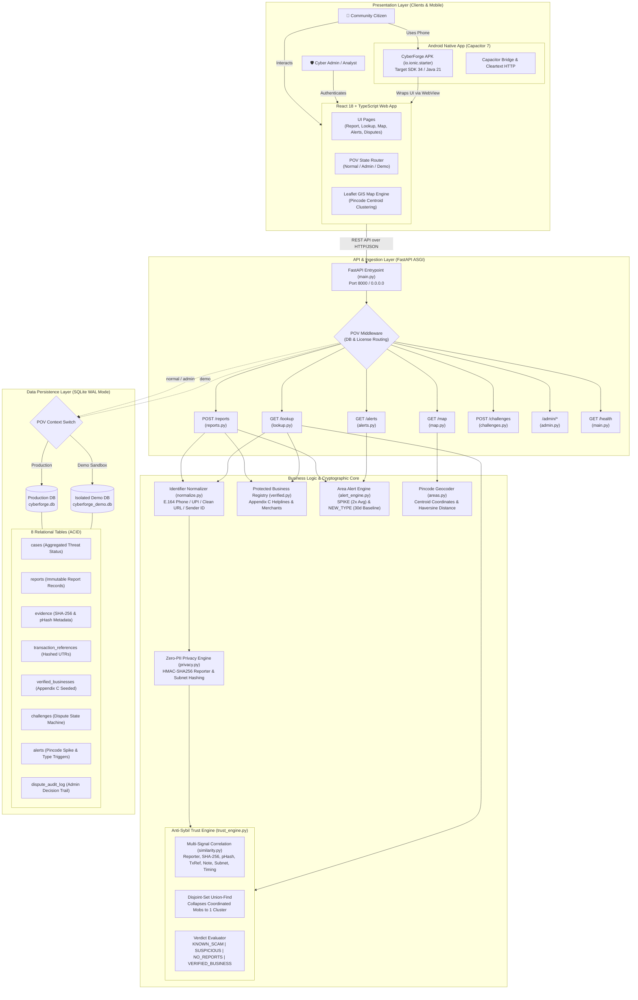
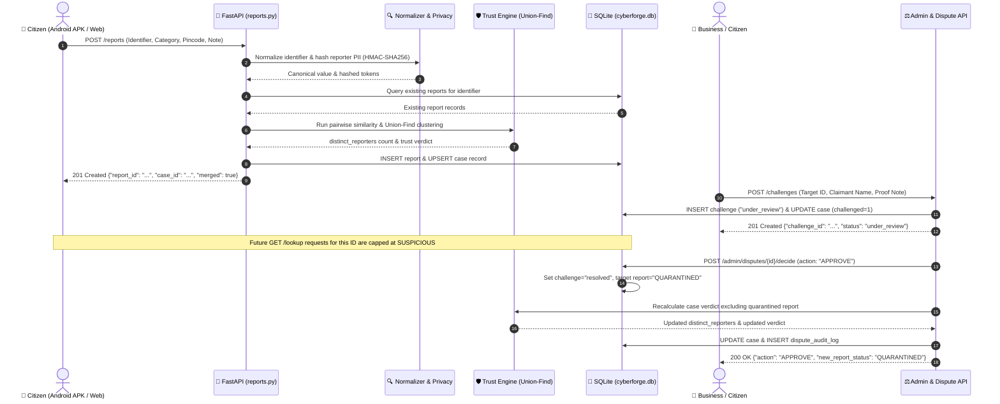

# CyberForge — System Architecture & Technical Design

---

## 1. High-Level Architectural Overview

CyberForge is structured into a four-tier architecture designed for speed, anonymity, and tamper-resistant trust evaluation:
1. **Presentation Layer**: Responsive React 18 / TypeScript single-page application and native Android Capacitor 7 WebView wrapper.
2. **API & Routing Layer**: High-throughput FastAPI ASGI application handling request lifecycle, authentication, CORS, and database routing based on user Point-of-View (POV).
3. **Business Logic & Cryptographic Engine**: Deterministic normalization, zero-PII HMAC hashing, pairwise multi-signal correlation scoring, and Union-Find graph clustering.
4. **Data Persistence Layer**: Concurrent dual-database SQLite architecture with Write-Ahead Logging (WAL) ensuring complete data isolation between production and demonstration environments.

---

## 2. Layer-by-Layer Architectural Breakdown

### 1. Presentation Layer (Frontend & Mobile)
- **Framework**: React 18 single-page application written strictly in TypeScript.
- **Styling**: Tailwind CSS utility classes styled for rapid mobile-first rendering.
- **Routing**: Client-side hash routing (`/#/report`, `/#/check`, `/#/map`, `/#/alerts`, `/#/admin`, `/#/license`). Hash routing was deliberately chosen so the application functions identically whether hosted from an HTTP server or loaded internally inside an Android `file:///android_asset/` or Capacitor WebView.
- **Geographic Visuals**: Leaflet and React-Leaflet render geographic circles around postal PIN code centroids. Coordinates are fetched dynamically from the backend without third-party geocoding dependencies.
- **Android Integration**: The web application is bundled inside an Android container using Capacitor 7. The native wrapper configures:
  - `AndroidManifest.xml`: Network security permission `<uses-permission android:name="android.permission.INTERNET" />`.
  - `network_security_config.xml`: Cleartext HTTP permission for local development IP addresses (`192.168.60.239:8000`), allowing physical mobile phones on the same Wi-Fi network to submit live scam reports and perform lookups.

### 2. API & Routing Layer (FastAPI ASGI)
- **FastAPI Engine**: Mounted on `http://0.0.0.0:8000` to accept connections from both `localhost` and local area network (LAN) mobile devices.
- **POV Middleware (`license_and_pov_middleware`)**: Inspects the incoming `x-cyberforge-pov` HTTP header:
  - If `x-cyberforge-pov: demo`: Binds the database session thread-locally to `cyberforge_demo.db` and enforces the isolated 5-minute hackathon evaluation license.
  - If `x-cyberforge-pov: admin` or `normal`: Binds to `cyberforge.db` and enforces standard production license validations.
- **Dual Endpoint Mounting**: Mounts endpoints at both the root level (e.g. `/reports`, `/lookup`, `/map`, `/alerts`, `/admin/reset` per Mitigata specification) and under `/api/*` for standardized frontend AJAX consumption.

### 3. Business Logic & Cryptographic Engine
- **Deterministic Normalizer (`normalize.py`)**: Sanitizes and validates all user inputs before touching the database:
  - Phones: Strips spaces, dashes, brackets, and `+91`/`0` prefixes. Rejects numbers not matching Indian mobile (`[6-9]\d{9}`), landline STD, or toll-free (1800/1860) formats.
  - UPI IDs: Verifies `handle@bank` syntax, lowercases handles.
  - URLs: Strips protocol variations, removes tracking query parameters (`utm_*`, `fbclid`, `gclid`), and normalizes hostnames.
  - SMS Headers: Validates 6-character telecommunication sender IDs (e.g., `VM-HDFCBK` -> `HDFCBK`).
- **Zero-PII Privacy Engine (`privacy.py`)**:
  - Reporter ID: Hashed via `HMAC-SHA256(key=HMAC_SECRET, message=reporter_id)`. The original reporter ID is destroyed from RAM immediately after ingestion.
  - IP Subnet: Extracts `/24` prefix (e.g., `103.21.58.0`) and hashes via `HMAC-SHA256`. Preserves ability to detect bot farms operating on the same subnet without ever recording the citizen's actual IP address.
  - Note Fingerprint: Strips punctuation, collapses whitespace, and generates a SHA-256 digest of report descriptions to instantly flag copy-pasted scam scripts.
- **Anti-Sybil Trust Engine (`trust_engine.py` & `similarity.py`)**:
  - Computes pairwise correlation scores between all reports submitted against the same identifier.
  - Utilizes a Disjoint-Set Union-Find data structure with path compression to calculate connected components.
  - Returns `distinct_reporters`: the true count of independent, uncorrelated reporting clusters.
- **Protected Registry (`verified.py`)**:
  - Contains hardcoded, certified helplines (TRAI 1909, Cybercrime 1930), bank customer care numbers, verified SMS sender IDs, and official government portals.
  - Bypasses community trust calculations: verified entities always yield `VERIFIED_BUSINESS` and are immune to community-driven scam designations.

### 4. Data Persistence Layer (SQLite with WAL Mode)
- **Database Engine**: Python's native `sqlite3` configured with `PRAGMA journal_mode=WAL` (Write-Ahead Logging).
- **Concurrency & Speed**: WAL mode allows concurrent readers to access tables without blocking writers, delivering sub-millisecond query responses under high query volumes.
- **Schema Design**: 8 strictly typed relational tables enforcing referential integrity, unique constraints, and indexed queries.

---

## 3. Communication & Data Flow Sequence

---

## 4. Key Architectural Design Decisions & Trade-Offs

| Decision | Alternative Considered | Why CyberForge Chose This Approach |
|---|---|---|
| **Deterministic Heuristics & Graph Clustering instead of Machine Learning** | Fine-tuned LLM or Random Forest classifier | **Zero Hallucinations & Absolute Auditability**: In legal disputes and cybercrime reporting, a false scam accusation destroys lives and businesses. A deterministic algorithm with explicit mathematical weights (0.40 HMAC, 0.35 SHA-256, etc.) can be defended in court or before judges, requires zero GPU overhead, and runs in sub-10 milliseconds. |
| **HMAC-SHA256 Hashing instead of Raw Database Storage** | Storing plain text IPs and reporter contact details | **Zero-PII Compliance & Whistleblower Protection**: Eliminates citizen fear of retaliation. If the CyberForge database were ever breached, attackers would find zero IP addresses, zero reporter phone numbers, and zero personal names. |
| **SQLite with WAL Mode instead of PostgreSQL/MySQL** | Hosted PostgreSQL cluster | **Zero Deployment Overhead & Complete Portability**: CyberForge runs anywhere—on a laptop, an edge Raspberry Pi, an offline workstation, or inside a container—without configuring database users, ports, passwords, or network listeners. WAL mode easily handles thousands of requests per second. |
| **Pincode Centroid Clustering instead of GPS Coordinates** | Requesting browser GPS geolocation | **Victim Privacy Preservation**: Displaying an exact GPS coordinate on a map risks pinpointing a victim's private home. Grouping by 6-digit postal PIN code centroids protects victim privacy while alerting the neighborhood. |
| **Client-Side Hash Routing (`/#/`) instead of HTML5 History PushState** | Standard browser pathname routing (`/report`) | **Native Android File Compatibility**: PushState routing fails inside native Android WebViews when local asset files are served (`file:///`). Hash routing guarantees seamless cross-platform execution on both web browsers and native APKs. |

