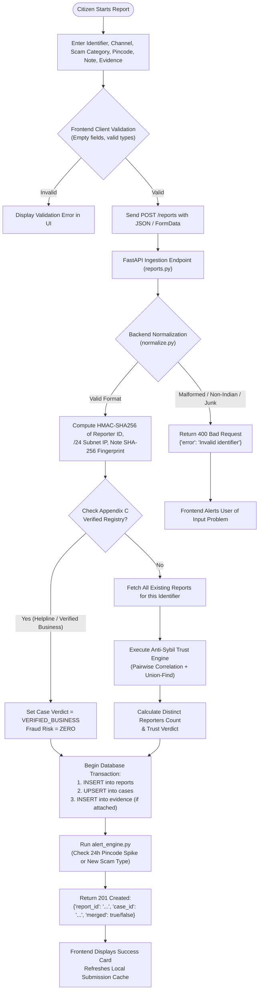
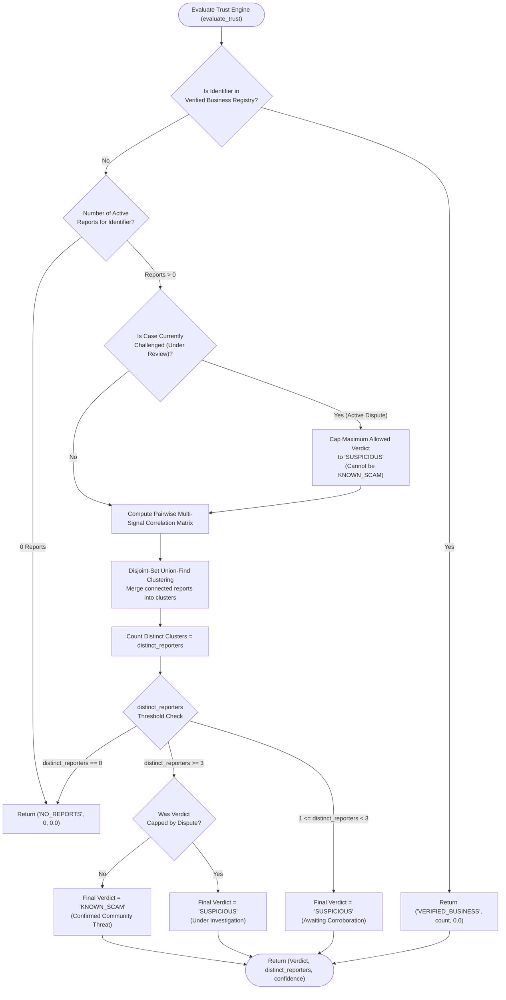
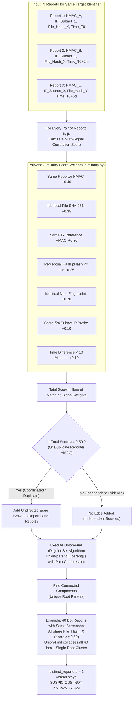
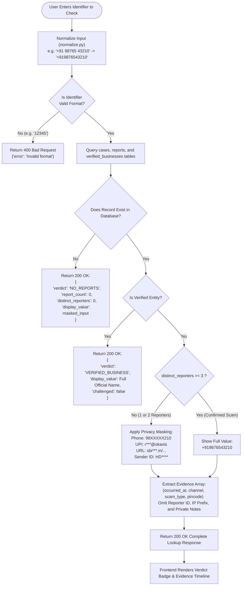
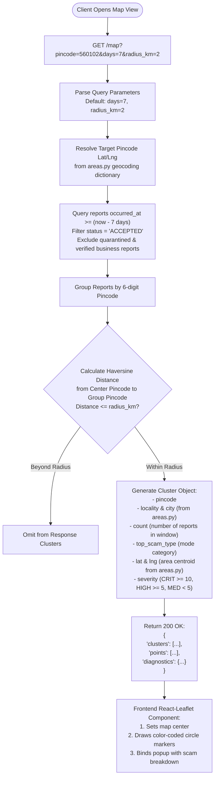
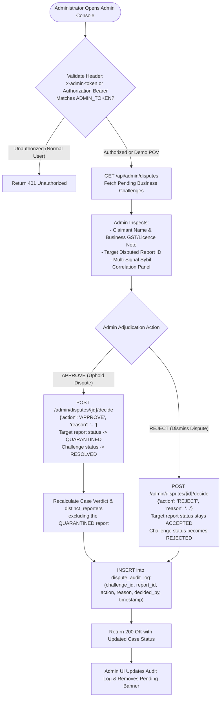
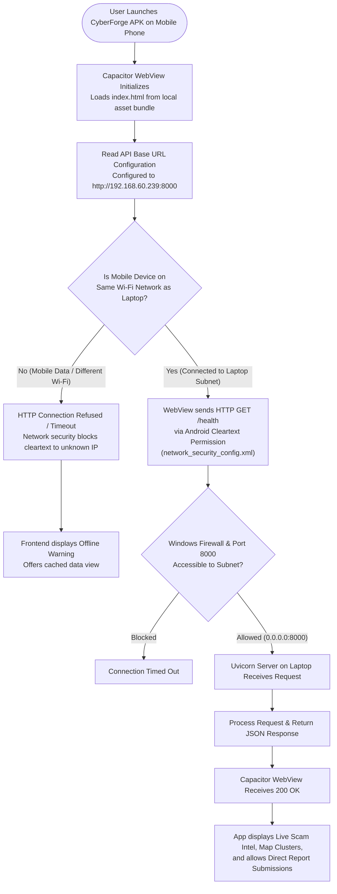

# CyberForge — Complete System Workflow Flowcharts
*Visual and Algorithmic Flowcharts of Core Platform Processes*

---

## Flowchart 1: Scam Reporting Workflow

---

## Flowchart 2: Trust Engine Decision Workflow

---

## Flowchart 3: Anti-Sybil Multi-Signal & Union-Find Clustering

---

## Flowchart 4: Identifier Lookup & Privacy Masking

---

## Flowchart 5: Geospatial Scam Map Generation

---

## Flowchart 6: Admin Investigation & Dispute Adjudication

---

## Flowchart 7: Native Android Connectivity & Local Synchronization

